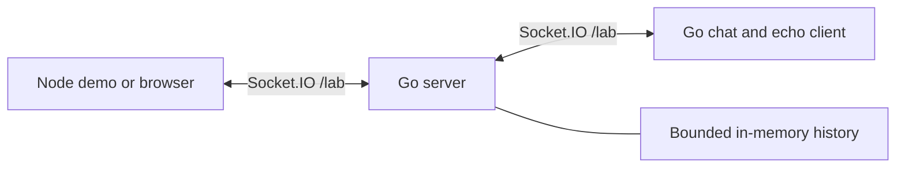

# Socket.IO live lab — Go server and client

A runnable example of [go-socket.io](https://github.com/sshaplygin/go-socket.io):
a Go server, an independent authenticated Go chat/echo bot, and a small Node client
that demonstrates a real round trip. No database, Redis, or portfolio checkout is
required. Messages are ephemeral and history is bounded.

## Quick start with Docker

Requires Docker Compose and Node 22.18+ with npm. Go builds inside Docker.

```sh
git clone https://github.com/sshaplygin/socketio-live-lab.git
cd socketio-live-lab
npm ci
npm run lab:docker:up
npm run demo
```

The demo connects as a regular participant, prints connection counts and RTT,
sends `/quote`, prints the Go bot's reply, then disconnects. It needs no private
credentials. Set `LAB_SERVER_URL` to test a different local server.

`lab:docker:up` generates `.env.docker` with independent random bot and metrics
secrets, mode 0600, only if the file is absent. Existing settings are preserved.
The server listens on **127.0.0.1:8080**; the bot connects over the private Compose
network and publishes no ports. This command does not start a proxy or request TLS.

```sh
npm run lab:docker:status
npm run lab:docker:logs
npm run lab:docker:down
```

After initialization, the equivalent Compose command is:

```sh
docker compose --env-file .env.docker up -d --build --wait
```

Change `LAB_HTTP_PORT` in `.env.docker` to use another host port. The internal bot
URL stays `http://server:8080`. Both containers run as UID 10001 with read-only
filesystems, dropped capabilities and resource limits. Keep one server replica.
The Dockerfile has separate `server` (default) and `bot` targets:

```sh
docker build --target server -t live-lab-server .
docker build --target bot -t live-lab-bot .
```

## Run Go directly

Requires Go 1.25+. The server and bot have no Node dependency.

```sh
cp .env.example .env
# Replace both example secrets with independent random values.
set -a
. ./.env
set +a
go run ./cmd/server
```

In another terminal, load the same environment and run the client:

```sh
set -a
. ./.env
set +a
go run ./cmd/bot
```

Optionally run `npm ci && npm run demo` in a third terminal. Go commands do not
load dotenv files automatically. Never expose `LAB_BOT_TOKEN` or
`LAB_METRICS_TOKEN` to a browser. Without a bot token, normal chat still works.

## Explore the code

- [`cmd/server/main.go`](cmd/server/main.go): HTTP/Socket.IO process lifecycle.
- [`cmd/bot/main.go`](cmd/bot/main.go): Go client authentication, events, replies and reconnects.
- [`internal/lab`](internal/lab): rooms, identities, presence, bounded history and limits.
- [`scripts/demo.mjs`](scripts/demo.mjs): small ordinary client using bootstrap, ACKs and events.
- [`docs/contracts.md`](docs/contracts.md): complete wire protocol and synchronization contract.
- [`tests`](tests): real-client integration and isolated Docker checks.



The bot replies only to recent human messages while people remain in the chat.
It answers `/ping`, `/quote`, `/joke`, `/help`, and ordinary messages in Everyone
and Developers. Explicit commands bypass the automatic reply cooldown; sender
rate limits still apply. Quotes credit scientists from Docker/Moby's naming
pool; sources are in [`bot_quotes.go`](internal/lab/bot_quotes.go).

### Browser playground

The full chat UI lives separately in
[sshaplygin.dev](https://github.com/sshaplygin/sshaplygin.dev). Once the portfolio
commit containing the lab is available in your checkout:

```sh
git submodule update --init --recursive
npm ci
PUBLIC_LIVE_LAB_URL=http://localhost:8080 npm run dev
# Open http://localhost:4321/labs/socketio/ in two windows.
```

The portfolio pins this repository as `services/live-lab`. It provides chat rooms,
RTT every five seconds, connection counts, Go echo and explicit polling/WebSocket
switching. `LAB_ALLOWED_ORIGINS` must include the browser's exact origin.

### Protocol compatibility

This example uses Engine.IO protocol 3 / Socket.IO protocol 4: JS
`socket.io-client@2.5.0` and the root Go module pinned to commit `0fa1ead74224`
(pseudo-version `v1.4.3-0.20261021122608-0fa1ead74224`). It does not use Socket.IO
v4 clients. At the original version check, no v1.5.0 tag was available; v1.4.2
used the old module path and did not include the Go client needed here.

## Configuration

| Environment | Default | Meaning |
| --- | --- | --- |
| `LAB_ADDR` | `127.0.0.1:8080` | HTTP listen address |
| `LAB_ALLOWED_HOSTS` | `localhost:8080,127.0.0.1:8080` | Exact Host header allowlist, including port |
| `LAB_ALLOWED_ORIGINS` | `http://localhost:4321,http://127.0.0.1:4321` | Exact browser origin allowlist |
| `LAB_BOT_TOKEN` | empty | Private bot credential; empty disables bot authentication |
| `LAB_METRICS_TOKEN` | empty | Private bearer credential for `/metrics`; empty disables it |
| `LAB_SERVER_URL` | `http://127.0.0.1:8080` | Bot's server origin |
| `LAB_SUBMISSIONS_ENABLED` | `true` | Emergency switch; false rejects messages and echoes |
| `LAB_MAX_CLIENTS` | 200 | Maximum Engine.IO sessions and `/lab` namespace registry size |
| `LAB_MAX_IDENTITIES` | 2000 | Maximum cached cosmetic identities; never evict active identities |
| `LAB_HISTORY_LIMIT` | 100 | Events per logical stream |
| `LAB_HISTORY_BYTES` | 1048576 | Combined event storage accounting budget |
| `LAB_HISTORY_SECONDS` | 900 | Event and idempotency TTL |
| `LAB_QUEUE_SIZE` | 64 | Per-connection application queue and transport write queue |

A total of four streams exist: global, general, developers, experiments. History
has count, age, and byte-accounting bounds. The configured byte budget accounts
for UTF-8 payload/metadata sizes plus a fixed overhead per event; it is not a
process RSS limit. Container memory limits provide the outer resource boundary.
At most 8192 message receipts are retained across the instance.
Each identity retains at most 128 message receipts for at most the history TTL;
retries beyond this bounded window can be accepted as new events.

Normal reloads retain identities in memory; inactive identities expire after 24
hours or capacity eviction. A hint deterministically restores the base name and
color after eviction/restart, but shuffled names and collision suffixes may change.
Hints are cosmetic, never trusted principals or authentication.

## Deployment configuration

`deploy/` contains an optional single-instance Caddy HTTPS configuration. Review
`deploy/.env.example`, set your own host/origins and secrets, and arrange DNS and
TLS before using it. Local scripts never invoke it. Deployment is manual and was
not performed as part of this example. Do not horizontally scale this in-memory
service.

Origin and Host validation applies to every request. Forwarded IP headers are
ignored. Behind a reverse proxy the source-IP handshake limit groups traffic by
proxy address; configure a reviewed edge limiter if a larger public admission
budget is needed. Requests, history, queues, connections and bot work are bounded.

## Operations and rollback

- `GET /healthz`: HTTP process liveness.
- `GET /readyz` and `GET /api/live-lab/status`: uncached authoritative availability;
  degraded when submissions are disabled, 503 during shutdown.
- `GET /metrics` with `Authorization: Bearer <LAB_METRICS_TOKEN>`: JSON counters and
  gauges. Caddy intentionally does not expose this endpoint publicly. Query it on
  the internal network; never put its secret in the browser.
- JSON structured logs contain lifecycle/errors, without messages, visitor IDs,
  source IPs, or credentials. Proxy access logs are disabled in the example.
- Change `LAB_SUBMISSIONS_ENABLED=false` and recreate the server to stop interactive
  submissions. Readiness becomes Degraded, and the page's explanatory content stays
  available. A process restart clears ephemeral history.
- Rollback: restore the previous server and bot images. A Go rollback/restart
  clears in-memory state; clients use the new boot ID to detect the history gap.
- Stop the optional bot independently with `docker compose stop bot`.

## Tests

```sh
go test -race ./...
go vet ./...
npm ci
npm run test:integration
npm run test:docker
```

Integration tests build real Go server/bot binaries with the race detector on
loopback port 18080. Docker tests use a separate Compose project and a temporary
loopback port, then remove their containers and secrets. The browser UI and its
Playwright tests remain in the portfolio repository. No test deploys anything.
